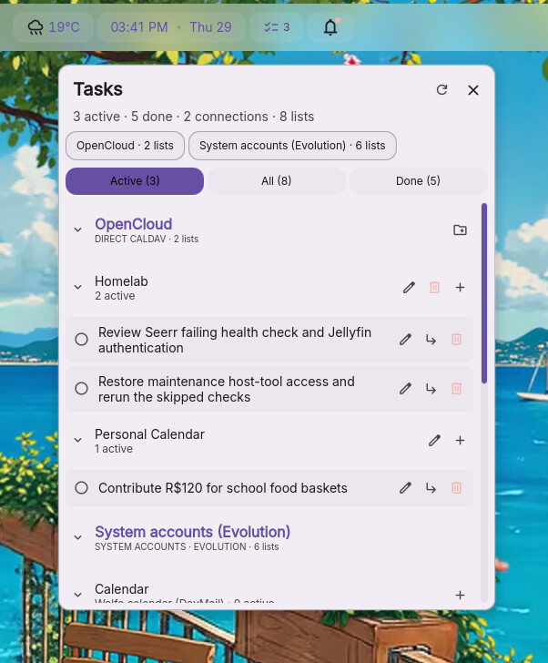

# CalDAV Tasks for DankMaterialShell

A multi-provider **task** widget with the compact card UI of
[Dank Todo](https://github.com/deepu105/dms-dank-todo), not an agenda/calendar widget.
Plugin ID: `caldavTasks`. Version: **0.5.1**.



## Android companion

Take the same grouped, collapsible task-list workflow to your phone with
[CalDAV Tasks for Android](https://github.com/brunofin/caldav-tasks-android): a native
Material 3 app with multiple CalDAV accounts, Active / All / Done filters, subtasks,
and a resizable home-screen task-list widget.

Configure the same CalDAV accounts separately in both clients to work with the
same tasks through your server. No direct device pairing or credential transfer
is needed. The Android app uses **direct CalDAV only**; Evolution/EDS system-account
support remains a feature of this desktop plugin.

## Features

- Multiple named connections, each with its own task lists.
- **Direct CalDAV** and **System accounts (Evolution)** providers. EDS discovers
  enabled task sources, including GOA-managed accounts, Google Tasks, CalDAV and
  local lists. System list headings show the list name and account underneath.
- Discover collections supporting `VTODO`; never display `VEVENT` calendar events.
- Add, rename and delete task-only lists on direct CalDAV connections.
- Read, add, edit titles, complete/reopen and permanently delete tasks.
- Display and create subtasks using `RELATED-TO` parent UIDs.
- Dank Todo's card layout, checkbox, inline composer, Active / All / Done filters,
  indentation and bar count. One scrollable view groups **every connection and
  every list**; there is no active connection/list and no selection dropdown.
- Connection headings are followed by list subheadings and task cards. Empty
  lists stay visible in every filter. Each list's `+` opens its own inline task
  composer; edit/subtask actions target that task's original connection/list.
- Bar counts, filters and read-only IPC span all enabled connections/lists.
- Native DMS list scrolling, toggles and tooltips, with theme-derived sizing for
  icon actions, rows and popout layout.
- Connections are ordered by total open tasks (most first); each connection's
  lists are ordered by their own open-task counts. Ties sort alphabetically.
  Ordering updates after synchronization and ignores filters and collapse state.
- An always-visible connection overview shows every connection and its list count.
  Click one to jump to its heading without filtering the view. The persistent
  scrollbar makes lists below the initial viewport easier to find.
- Connections and individual lists are independently collapsible: click a heading
  or its chevron. Folds are saved through DMS plugin state and synchronized across
  widget instances; new groups start expanded. Folding a provider preserves its
  list folds, drafts, global counts and background sync. Clicking a connection in
  the overview expands that provider without changing its child-list folds.
- Adding/editing a task automatically expands its target list/provider. Folding
  an open composer hides it without discarding its draft; expanding restores it.
- Refresh on opening, manual refresh, and periodic refresh (default 120 seconds).
- Per-source failure isolation; failed sources retain their last successful data
  **in memory**, with an error shown. No silent optimistic writes or offline queue.
- EDS also isolates failures per list and retains that list's last successful task
  data in memory. EDS owns its separate persistent cache and offline synchronization.
- Confirmation before permanent deletion. Deleting a task leaves its subtasks
  intact; missing-parent tasks appear at the top level.

## Install

Requires DankMaterialShell / Quickshell and Python 3.10+ with `caldav` 3.6+.
The backend currently uses `python3` from DMS's PATH.

```sh
python3 -c 'import caldav; print(caldav.__version__)'
mkdir -p "${XDG_CONFIG_HOME:-$HOME/.config}/DankMaterialShell/plugins"
git clone https://github.com/brunofin/dms-caldav-tasks.git \
  "${XDG_CONFIG_HOME:-$HOME/.config}/DankMaterialShell/plugins/caldavTasks"
dms ipc call plugin-scan scan
```

Do not overwrite an existing `caldavTasks` installation. Enable **CalDAV Tasks**
in DMS's Plugins settings and add it to your bar. The old `tasks` and `dankTodo`
widgets are independent and can remain installed.

For **Direct CalDAV**, add a connection name, an HTTPS CalDAV discovery URL,
username and app password. Refresh the widget to see all its lists together.
For OpenCloud/Radicale, use the server's CalDAV root, e.g.
`https://cloud.example.com/caldav/` (with a trailing slash).
No credentials or task data are automatically imported from other plugins.

### System accounts (Evolution)

Select **System accounts (Evolution)** in the new-connection provider dropdown,
give it a name, and save. No URL, username or password is needed. Only one system
connection is allowed; it discovers all enabled EDS task sources automatically.
Refresh the widget: all system lists appear beneath the system connection heading,
with account names beneath each list title. There is no active-list concept.

Requires system Python's `gi` (PyGObject) and the `EDataServer-1.2`, `ECal-2.0` and
`ICalGLib-3.0` introspection libraries, plus a running user D-Bus session and EDS
services. Check whether the introspection libraries are available with:

```sh
python3 -c 'import gi; gi.require_version("EDataServer", "1.2"); gi.require_version("ECal", "2.0"); gi.require_version("ICalGLib", "3.0")'
```

The provider uses the EDS Source Registry and ECal's **TASKS** client, not the
event client, GOA token extraction, or raw CalDAV URLs from system source files.
EDS handles authentication, OAuth refresh, certificates, cached data and remote
synchronization. This works under niri too; GNOME Shell is not required. An account
in GOA only appears here if EDS exposes a task source for it. Disabled sources and
disabled parent accounts are excluded.

The widget reads EDS's cache immediately rather than waiting for remote login.
Newly configured accounts can take a later refresh to populate. Successful EDS
writes mean **EDS accepted the change**; they may await server sync while offline.
Task-write permissions are checked through ECal and in the UI. Failed-list data
is displayed read-only until the list can be opened again.

**Create/rename/delete system lists in Evolution**, not this widget. These actions
are disabled in the UI and rejected by the backend: removing an ESource is not a
portable equivalent of deleting a remote task collection, and GOA-owned sources
may be managed by their parent account. Disconnecting the provider only removes
the plugin connection; it never removes GOA accounts or EDS sources.

### Lists and events

CalDAV uses calendar collections for both tasks and events. This widget lists only
collections advertising `VTODO`. Servers omitting the optional supported-component
property are treated according to CalDAV's default (all components supported).
Mixed collections are readable, but **cannot be deleted from this widget**:
deleting their collection could also delete events. Newly created lists request
support for `VTODO` only. Server permissions may disallow creating/renaming/deleting
collections; failures are shown rather than worked around destructively.

### Credentials

Connections are stored outside the repository and DMS settings:
`$XDG_CONFIG_HOME/dms-caldav-tasks/connections.json` (default `~/.config/…`).
Writes are atomic, with file permissions `0600` and a new directory mode of `0700`.
For direct connections this file contains **unencrypted passwords**: exclude it from dotfile repositories
and protect backups. Passwords are masked in settings, omitted from responses,
sent to the helper over stdin, and never placed in command-line arguments.
TLS verification is always enabled. URLs with embedded credentials or query
tokens are rejected. Blank passwords while editing keep the existing password.
Disconnecting an account only removes its local connection, never server data.
System connections store only a name, provider ID and enabled flag here; no EDS
credentials are read or copied. The direct-connection HTTPS restriction does not
override transport settings already managed by EDS.

## Scope of version 0.5

- Title editing only; due dates and recurrence metadata are read/preserved, not
  edited. Unknown iCalendar properties are preserved by component-level edits.
- Recurring tasks are displayed but completion/reopening is deliberately blocked
  until recurrence-safe behavior is implemented. Explicit deletion removes the
  task resource, including its recurrence series, not just a single occurrence.
- For the EDS provider, **all recurring-task mutations** are blocked for now
  (title edits, completion and deletion); edit those tasks in Evolution.
- Drag reordering/reparenting and moving tasks between lists are not implemented.
  Drag handles and bulk clear-completed controls are intentionally hidden.
- Direct CalDAV has no keyring integration, offline persistent cache, push sync
  or OAuth flow yet. System accounts inherit authentication/caching from EDS.
- Read-only/shared collections may be displayed; the server enforces write access.
- The Active / All / Done filter spans all providers. Empty groups are retained,
  so task/list actions remain accessible even when the current filter has no tasks.

## Architecture

| File | Purpose |
|---|---|
| `CalDAVTasks.qml` | Dank Todo-derived cards/composer, source/list management, sync state |
| `UI/TaskCard.qml` | Task card, indentation and task-specific actions |
| `UI/IconAction.qml` | Themed, keyboard-focusable icon action with tooltip |
| `Settings.qml` | Multi-source connection editor and refresh setting |
| `Backend.qml` | Asynchronous JSON-over-stdin Python process bridge |
| `backend.py` | Discovery, opaque identifiers, VTODO CRUD, private connection storage |
| `evolution_provider.py` | EDS Source Registry, TASKS clients, capabilities and system task CRUD |
| `task_model.py` | Provider-neutral VTODO mapping, identifiers and validation |

The Python helper accepts one JSON line on stdin and returns one JSON response.
Tasks are addressed by a source-scoped list ID and a list-scoped UID hash; mutation
targets are rediscovered rather than accepting arbitrary resource URLs from QML.
Mutations go through the selected provider, then refresh the display (EDS may
queue remote synchronization). Writes are serialized
per widget. Do not run multiple writable widget instances against the same tasks
if you need stronger concurrency guarantees; no cross-process mutation lock is used.

Read-only IPC:

```sh
dms ipc call caldavTasks refresh
dms ipc call caldavTasks list
dms ipc call caldavTasks count
dms ipc call caldavTasks status
```

Remote data can take about two seconds to appear. Check `status` for
`loading: false` before judging the populated UI or capturing it.

## Tests

```sh
python3 -m unittest discover -s tests -v
```

For real DAV tests, install `radicale` in a disposable virtual environment along
with the requirements. Tests start a localhost-only disposable server and never
read your real connections or modify existing remote accounts. Integration tests
skip when Radicale is unavailable.

EDS integration tests run real CRUD against local task lists in a **private
`dbus-run-session`** with disposable HOME/XDG directories. They never write to the
live user bus, real sources or remote accounts. The worker refuses to start without
the isolated test marker. Changing XDG paths alone is not sufficient isolation for
EDS; never run `tests/worker_eds.py` directly in the live session.

On a running Wayland session with DMS installed:

```sh
python3 tests/smoke.py
```

This loads the real DMS QML components in a separate Quickshell instance without
opening windows, using a private D-Bus session and temporary HOME/XDG/runtime
directories in temporary storage (`/tmp/opencode` when available, otherwise the
system temporary directory; override with `CALDAV_TASKS_TEST_TMPDIR`). It explicitly uses **light mode**, disables
matugen and portal theme sync, and checks the live desktop theme is unchanged. Set
`DMS_QML_ROOT` if DMS is not at `/usr/share/quickshell/dms`.
The fixture tests simultaneous provider/list groups, global counts/filters, empty
groups, read-only permissions and composer target isolation. An optional visual
preview uses only synthetic data:

```sh
CALDAV_TASKS_SCREENSHOT=/tmp/opencode/tasks-preview.png python3 tests/smoke.py
```

The fixture also checks open-task priority ordering, independent provider/list folds, unchanged counts,
nested-state preservation, saved-state restoration in a new widget instance,
draft retention, and automatic expansion for explicit actions. Collapse state
uses `PluginService.loadPluginState` / `savePluginState` under the `collapsedGroups`
key; no account credentials, connection settings or server data are changed.

## Credits

The UI is derived from Deepu K Sasidharan's MIT-licensed
`dms-dank-todo` (installed revision `ff1b82c3061fce3c32c8f65792fa81b928ab35d1`).
The existing [dms-tasks](https://github.com/AyoItsYas/dms-tasks) plugin was inspected
as a CalDAV integration reference; the backend here is a new implementation using
the Python `caldav` library. See `LICENSE` for the UI attribution.
